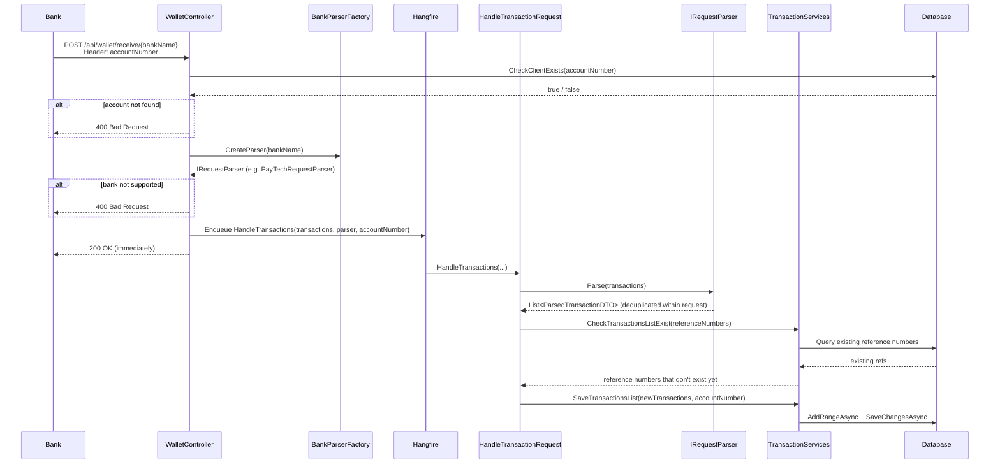
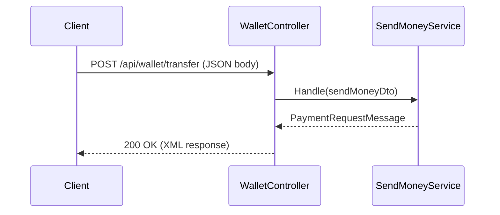
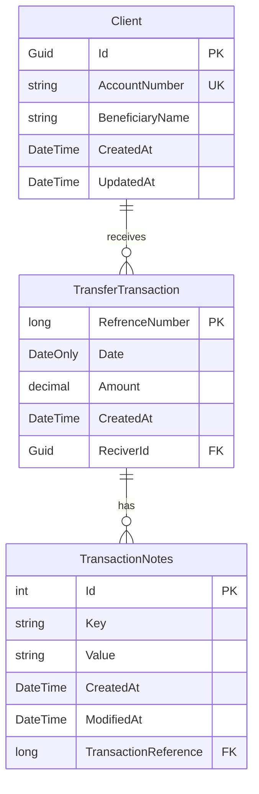

# Digital Wallet

A backend system built as part of a mentorship evaluation task to test system design skills and problem-solving — **without using AI**.

The challenge was straightforward on the surface: build a digital wallet that can receive money from banks, store transactions, and send money out. But the real challenge was thinking through every design decision from scratch — asking the right questions, drawing the right diagrams, and writing code that actually makes sense.

---

## The Story

This project was given to me as a mentorship task to evaluate how I think about system design and how I solve real-world backend problems. The constraint was simple: **no AI assistance**. Just me, the problem, and my ability to reason through it.

So I sat down, read the requirements, and started asking myself questions — one by one — until the system started to take shape.

---

## Challenges & How I Solved Them

### 1. Not Using AI
The biggest and most uncomfortable challenge. I'm used to having a shortcut. This time I had to slow down, think, draw, and reason. It forced me to actually understand every decision I made instead of just accepting a generated answer.

### 2. How Do I Parse the Bank Request?
The first real technical question. Banks send their own custom formats — not JSON, not XML, just raw text in the request body.

My solution: read the raw body directly from `Request.Body`, split it line by line (each line = one transaction), then parse each line by extracting substrings and splitting on `#` and `/`.

**PayTech format:**
```
yyyyMMddamount#referenceNumber#key1/value1/key2/value2
```

Example:
```
202610151500,00#987654321#Purpose/Salary/Memo/October
```

### 3. Different Request Structure Per Bank
What happens when a second bank joins the system with a completely different format? I didn't want to put `if/else` chains inside the controller.

I used a combination of the **Factory Pattern** and the **Strategy Pattern**:
- The bank name comes in the route: `POST /api/wallet/receive/{bankName}`
- `BankParserFactory` maps the bank name to the correct parser class
- Each parser implements `IRequestParser` and handles its own format

Adding a new bank = create a new parser class + register it in the factory. Nothing else changes.

```csharp
// Factory creates the right parser based on bank name
var parser = await _bankParserFactory.CreateParser(bankName);
```

### 4. What Should I Store in the Database?
I had to think about what "a transaction" really means and what extra metadata banks might attach to it.

I landed on three tables:
- **Client** — the account holder
- **TransferTransaction** — the core transaction (reference number, amount, date, receiver)
- **TransactionNotes** — a key-value table for arbitrary metadata per transaction (like `Purpose: Salary`)

This way the schema stays clean and I'm not adding random nullable columns every time a bank sends a new field.

### 5. Deduplication — Don't Save the Same Transaction Twice
This was a two-layer problem:

**Layer 1 — Within the same request:** A bank might accidentally send the same transaction twice in the same payload. I filter duplicates from the parsed list before doing anything with them, checking by reference number.

**Layer 2 — Against the database:** Before saving, I take all reference numbers from the parsed list, check which ones already exist in the database, and only process the ones that don't.

```csharp
var unexistedTransactions = parsedTransactions
    .Where(t => unexistedRefs.Contains(t.ReferenceNumber));
```

### 6. Heavy Processing Shouldn't Block the API
Parsing and saving hundreds of transactions is not something the request should wait for. The bank sends the payload and should immediately get a `200 OK` back.

I used **Hangfire** to offload the entire processing pipeline to a background job. The controller enqueues the job and returns immediately. Hangfire handles execution, retries, and monitoring.

```csharp
BackgroundJob.Enqueue(() => _service.HandleTransactions(transactions, parser, accountNumber));
return Ok();
```

### 7. The Request Has No Receiver Account Number
The bank payload only contains transaction data — no field for "who is this money going to?" I had to figure out how to connect the transaction to the right client.

My assumption: the receiving system knows who it's receiving for. So I pass the **account number in the request header** (`accountNumber`). The API validates the account exists before processing anything.

```
POST /api/wallet/receive/PayTech
Header: accountNumber: 1234567890
```

### 8. Which Parser Should Handle This Request?
Simple: pass the bank name as a **route parameter**. The factory checks the name and returns the right parser. If the bank name is unknown, it returns `null` and the API responds with `400 Bad Request`.

### 9. The Send-Money Endpoint Returns XML
The requirement was explicit: **only generate the XML message**. Actually sending it to a bank or tracking the transfer in the database is out of scope. The endpoint takes a `SendMoneyDTO`, builds a structured `PaymentRequestMessage`, and returns it serialized as XML — ready to be forwarded to whatever channel the bank integration uses.

```
POST /api/wallet/transfer
Content-Type: application/json
Accept: application/xml
```

---

## Architecture

The project follows a **Clean Architecture** approach, split into four layers:

```
Digital-Wallet/
└── SRC/
    ├── DigitalWallet.API           → Controllers, entry point, DI setup
    ├── DigitalWallet.CORE          → Business logic, services, DTOs, interfaces
    ├── DigitalWallet.Domain        → Domain models, repository interfaces
    └── DigitalWallet.Infrastrucutre → EF Core DbContext, repositories, migrations
```

### Dependency Direction
```
API → CORE → Domain ← Infrastructure
```

- **API** depends on CORE (uses service interfaces)
- **CORE** depends on Domain (uses repository interfaces)
- **Infrastructure** implements Domain interfaces (no business logic lives here)

This means CORE and Domain never reference Infrastructure — the database is just a detail.

---

## Sequence Diagrams

### Receive Money Flow



### Send Money Flow



---

## Database Design

### ERD



### Design Decisions

- **`RefrenceNumber` is the PK of `TransferTransaction`** — it's the bank's reference number, which is already unique. No need for a surrogate key.
- **`AccountNumber` has a unique index** on `Client` — prevents duplicate client records for the same account.
- **`TransactionNotes` is a key-value table** — banks attach arbitrary metadata to transactions. Instead of nullable columns, each note is its own row with a `Key` and `Value`. Clean, extensible, and easy to query.

---

## How to Run

### Prerequisites
- [.NET 10 SDK](https://dotnet.microsoft.com/download)
- SQL Server (local or remote)

### 1. Configure the Connection String

Open `SRC/DigitalWallet.API/appsettings.json` and update the connection string:

```json
{
  "ConnectionStrings": {
    "ApplicationDb": "Server=YOUR_SERVER; Database=DigitalWallet; User Id=YOUR_USER; Password=YOUR_PASSWORD; Encrypt=True; TrustServerCertificate=True; MultipleActiveResultSets=True;"
  }
}
```

### 2. Apply Migrations

```bash
cd SRC/DigitalWallet.Infrastrucutre
dotnet ef database update --startup-project ../DigitalWallet.API
```

### 3. Run the API

```bash
cd SRC/DigitalWallet.API
dotnet run
```

The API will be available at `https://localhost:{port}`.

### 4. Hangfire Dashboard

Navigate to `/hangfire` to monitor background jobs.

---

## API Endpoints

### Receive Money
```
POST /api/wallet/receive/{bankName}
Header: accountNumber: {accountNumber}
Body (raw text):
  20261015#1500,00#987654321#Purpose/Salary/Memo/October
  20261016#2000,00#987654322#Purpose/Bonus
```

| Parameter | Location | Description |
|---|---|---|
| `bankName` | Route | Name of the sending bank (e.g. `PayTech`) |
| `accountNumber` | Header | The receiving client's account number |

**Response:** `200 OK` — processing happens in the background via Hangfire.

---

### Send Money
```
POST /api/wallet/transfer
Content-Type: application/json
Accept: application/xml
```

**Request Body:**
```json
{
  "amount": 1500.00,
  "currency": "EGP",
  "senderAccountNumber": "1234567890",
  "receiverAccountNumber": "0987654321",
  "receiverBankCode": "PAYTECH",
  "receiverBeneficiaryName": "John Doe",
  "notes": ["Salary", "October"],
  "paymentType": "99",
  "chargeDetails": "SHA"
}
```

**Response:** XML `PaymentRequestMessage` ready for bank transmission.

---

## Tech Stack

| Technology | Purpose |
|---|---|
| ASP.NET Core 10 | Web API framework |
| Entity Framework Core | ORM / database access |
| SQL Server | Relational database |
| Hangfire | Background job processing |
| XML Serialization | Send-money response format |

---

## Best Practices Applied

- **Clean Architecture** — strict separation between API, business logic, domain, and infrastructure
- **Dependency Inversion** — all layers depend on interfaces, not concrete classes
- **Factory + Strategy Pattern** — extensible bank parser system; adding a new bank requires zero changes to existing code
- **Two-layer deduplication** — protects against duplicate transactions both within a single request and across requests
- **Fire-and-forget background processing** — API stays responsive regardless of payload size
- **No business logic in controllers** — controllers are thin; they validate, delegate, and respond
- **No business logic in repositories** — repositories only talk to the database

---

*Built by Ahmed Mohamed Eltwab*
